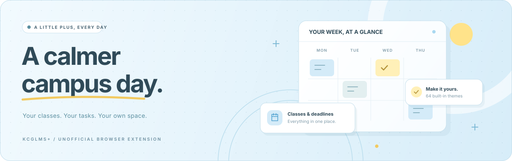

<p align="center">
  
</p>

<h1 align="center">KCGLMS+</h1>

<p align="center">
  <strong>学生ポータルに、もうひとつの使いやすさ。</strong><br>
  授業も、課題も、お知らせも。毎日の確認を、ひとつの画面で。
</p>

<p align="center">
  <a href="LICENSE"></a>
  <a href="#対応環境"></a>
  <a href="app/wxt.config.ts"></a>
  <a href="#開発"></a>
</p>

<p align="center">
  <a href="#できること">できること</a> &nbsp; · &nbsp;
  <a href="#開発">開発に参加</a> &nbsp; · &nbsp;
  <a href="https://github.com/nnnnnnn0090/KCGLMS-Plus/issues">Issueを送る</a>
</p>

<p align="center">
  
</p>

> [!IMPORTANT]
> **個人が開発している非公式のブラウザ拡張機能です。** KCGおよび学校関係者は、開発・運営・審査・サポートに関与していません。

## できること

<table>
<tr>
<td width="50%" valign="top">
<h3>01 / Calendar</h3>
<strong>今日の授業と、次の締め切り。</strong>
<p>授業・課題・補講・キャンパス予定を週／月カレンダーに集約。シラバスやKing LMSのコースへ、そのまま移動できます。</p>
</td>
<td width="50%" valign="top">
<h3>02 / Portal</h3>
<strong>探す時間を、もっと短く。</strong>
<p>お知らせ、拾得物、休講・補講・教室変更、アンケートを整理。よく使うページはショートカットにまとめて並べ替え。</p>
</td>
</tr>
<tr>
<td width="50%" valign="top">
<h3>03 / Personalize</h3>
<strong>自分の好きな、見やすさに。</strong>
<p>64種類のテーマと複数の日本語Webフォント。独自テーマの作成・複製・書き出しや、カレンダー・プロフィールの表示調整にも対応。</p>
</td>
<td width="50%" valign="top">
<h3>04 / My schedule</h3>
<strong>授業の外の予定も、一緒に。</strong>
<p>繰り返し・日付指定の予定に、時刻、メモ、URLを追加。JSONでの書き出し／読み込みと、マイリンク同期による端末間共有ができます。</p>
</td>
</tr>
<tr>
<td width="50%" valign="top">
<h3>05 / Connected</h3>
<strong>メールも、時間割も、同じ使い心地。</strong>
<p>WebメールとCampus Planにも共通のテーマと操作感を適用。それぞれの表示切り替えは、設定から個別に調整できます。</p>
</td>
<td width="50%" valign="top">
<h3>06 / Languages</h3>
<strong>いつもの言語で、迷わず使う。</strong>
<p>日本語、英語、中国語（簡体・繁体）、韓国語、インドネシア語、ネパール語、タイ語、ベトナム語のUIと、初回ガイドを用意。</p>
</td>
</tr>
</table>

<details>
<summary><strong>King LMSとの連携・「みんなの活動」について</strong></summary>

### King LMSとの連携

King LMSで取得したコース一覧と課題期限をブラウザ内へ保存し、ポータル側のカレンダーへ反映します。再取得が必要な場合は、設定または課題カレンダーからKing LMSへ移動し、完了後にポータルへ戻ります。

### 「みんなの活動」

ポータルから開ける独立したコミュニティ機能です。学校のサービスではなく、投稿とプロフィールは学校とは別のコミュニティサーバーへ送信されます。初回表示時にこの点を説明し、明示的な同意を求めます。学校のログインIDやパスワードを入力しないでください。

</details>

## しくみ

KCGLMS+は、ログイン済みのページから必要な情報を読み取り、React製のオーバーレイとして表示するManifest V3拡張機能です。

```text
学生ポータル ─┐
King LMS ─────┤   ログイン済みのページ    KCGLMS+
Webメール ────┼─→ から情報を読み取り ─→ 使いやすい画面へ
Campus Plan ──┘
```

学校のサーバーや保存データを置き換える仕組みではありません。拡張機能を無効にすると元の表示へ戻せます。

## 対応環境

| ブラウザ                     |   最低バージョン | 出力形式    |
| ---------------------------- | ---------------: | ----------- |
| Google Chrome                |              111 | Manifest V3 |
| Microsoft EdgeなどChromium系 | Chromium 111相当 | Manifest V3 |
| Mozilla Firefox              |              140 | Manifest V3 |

Firefox Android向けmanifestの最低バージョンは142です。対応値の正本は [`app/wxt.config.ts`](app/wxt.config.ts) にあります。

KCGLMS+を利用するには、各対象サービスへ通常どおりログインできるKCG学生アカウントが必要です。

## データとプライバシー

表示設定やKing LMSのコース・課題情報は、ブラウザの拡張機能ストレージに保存します。テーマや予定を共有するマイリンク同期と、任意のコミュニティ機能も利用できます。

権限や同期の挙動は以下を確認してください。

<details>
<summary><strong>ブラウザ権限・保存データ・端末間同期の詳細</strong></summary>

### ブラウザ権限

通常のブラウザ権限は `storage` のみです。加えて、機能を提供するページへコンテンツスクリプトを配置し、必要なAPIへ接続するため、次のホスト権限を使用します。

| ホスト                                       | 用途                                                   |
| -------------------------------------------- | ------------------------------------------------------ |
| `home.kcg.ac.jp`                             | 学生ポータルとCampus Planの表示、ポータルAPI、設定同期 |
| `king-lms.kcg.edu`                           | コース一覧と課題期限の取り込み                         |
| `home2.kcg.ac.jp`                            | Webメールの表示                                        |
| 拡張機能の配布サーバー | 更新情報、お知らせ、アンケート、稼働状態の確認         |
| `portal-community.com`                       | 任意のコミュニティ機能                                 |

生成される正確なmanifestは [`app/wxt.config.ts`](app/wxt.config.ts) と [`app/src/contract/origins.ts`](app/src/contract/origins.ts) から構成され、CIで固定済みmanifestと比較されます。

### ブラウザ内に保存するデータ

表示設定、独自テーマ、追加予定、ショートカット設定、King LMSから取得したコース・課題情報などを拡張機能のストレージへ保存します。学校のページへ入力するパスワードを、KCGLMS+の設定データとして保存することはありません。

### マイリンクを使った端末間同期

「設定 → 連携 → 設定の同期」を有効にすると、テーマや追加予定などを学生ポータルのマイリンク内に専用レコードとして保存します。専用レコードはKCGLMS+のショートカット画面では表示されません。

- 未設定時の同期は有効です。
- 無効にすると、その端末からポータル上の同期レコードを削除します。
- 別の端末で同期が有効なままの場合、その端末からレコードが再作成されることがあります。
- 1回の同期で作成できる専用レコード数には上限があります。上限を超えたデータはアップロードされず、ローカル側に残ります。

同期データは、有効な `VITE_TELEMETRY_HMAC_SECRET` がビルド時に設定されている場合、AES-256-GCMで暗号化されます。未設定のビルドでは互換用の非暗号化形式で保存されるため、配布用成果物を作る場合は必ず設定してください。自前ビルドで設定しない場合は、マイリンク同期を無効にすることを推奨します。

利用前に、配布元のプライバシーポリシーを確認してください。

</details>

## 開発

React 19 / TypeScript / WXTを使用しています。開発手順、検証方法、構成の詳細は以下から確認できます。

<details>
<summary><strong>開発環境・ビルド・品質チェック</strong></summary>

### 必要なもの

- Node.js 22.12以降（CIと同じバージョンを推奨）
- npm
- ChromeまたはFirefox

拡張機能のプロジェクトルートは `app/` です。

```bash
cd app
npm ci
```

ローカル固有の設定が必要な場合は、テンプレートをコピーします。`.env.local` はGit管理されません。

```bash
cp .env.example .env.local
```

| 変数                               | 用途                               |
| ---------------------------------- | ---------------------------------- |
| `VITE_PORTAL_DISCORD_INVITE_URL`   | 設定画面へ表示するDiscord招待URL   |
| `VITE_EXTENSION_FEEDBACK_FORM_URL` | バグ報告・機能リクエストフォーム   |
| `VITE_MASCOT_ILLUSTRATOR_NAME`     | マスコット作者の表示名             |
| `VITE_MASCOT_ILLUSTRATOR_URL`      | マスコット作者のプロフィールURL    |
| `VITE_TELEMETRY_HMAC_SECRET`       | 配布ビルドの署名と同期データ暗号化 |

秘密値を `.env.local` 以外の追跡対象ファイルへ書かないでください。

### 開発サーバー

```bash
npm run dev          # Chromium
npm run dev:firefox  # Firefox
```

WXTがブラウザ別の成果物を `app/.output/` へ生成します。

### ビルドとパッケージ

```bash
npm run build          # Chromium開発ビルド
npm run build:firefox  # Firefox開発ビルド
npm run zip            # Chromium配布ZIP
npm run zip:firefox    # Firefox配布ZIP
```

リポジトリ直下のスクリプトは、開発用・配布用の両ブラウザ向けZIPをまとめて `build/` へ出力します。

```bash
./build.sh
```

バージョン番号の正本は [`app/version.json`](app/version.json) です。

### 品質チェック

```bash
npm run lint
npx tsc --noEmit
npx depcruise src --config .dependency-cruiser.cjs
npm run type-coverage
npm run format:check
npm run test:coverage
```

CIではこれらに加えて、次の項目を確認します。

- Chrome・Firefoxの配布ビルド
- manifest、CSS、契約、翻訳、テーマトークンの基準値
- 同じコミットから同一成果物を生成できること
- 未パッケージ拡張の起動テスト
- 実際の対象サービスを使ったE2Eフロー

固定基準の検証と更新方法は [`golden/README.md`](golden/README.md) を参照してください。

### E2E

```bash
cd app
npm run build
npm run test:e2e
```

実サービスを使うフローテストには認証情報が必要です。必要な環境変数と実行時の注意事項は [`app/e2e/README.md`](app/e2e/README.md) にまとめています。認証情報をリポジトリへ保存しないでください。

</details>

### ソースからインストール

<details>
<summary><strong>Chrome・Edge・Firefoxで開発ビルドを試す</strong></summary>

ソースからChromium向け開発ビルドを作る場合は、次の手順を使います。

```bash
git clone https://github.com/nnnnnnn0090/KCGLMS-Plus.git
cd KCGLMS-Plus/app
npm ci
npm run build
```

ChromeまたはEdgeで拡張機能管理画面を開き、デベロッパーモードを有効にして、`app/.output/chrome-mv3` を「パッケージ化されていない拡張機能」として読み込みます。

Firefox向けは `npm run build:firefox` を実行し、`about:debugging` の「一時的なアドオンを読み込む」から `app/.output/firefox-mv3/manifest.json` を選択します。

> [!NOTE]
> 開発ビルドにはローカルE2Eサーバー用の権限が追加されます。配布用成果物には含まれません。

</details>

### アーキテクチャ

<details>
<summary><strong>レイヤ構成・ディレクトリ・データの流れ</strong></summary>

コードは、ブラウザ依存と業務ロジックを分離するレイヤ構成です。

```text
contract → platform / domain → services → ui → entrypoints
```

| ディレクトリ           | 役割                                                       |
| ---------------------- | ---------------------------------------------------------- |
| `app/src/contract/`    | URL、メッセージ、ストレージキーなどの安定した境界          |
| `app/src/platform/`    | ブラウザストレージ、メッセージングなど環境依存の処理       |
| `app/src/domain/`      | カレンダー、テーマ、設定、翻訳などの純粋なドメインロジック |
| `app/src/services/`    | ポータル、King LMS、同期処理を組み立てるユースケース       |
| `app/src/ui/`          | Reactコンポーネント、ページ、カレンダーUI                  |
| `app/src/entrypoints/` | WXTのbackground/content scriptエントリ                     |
| `app/src/styles/`      | ポータル、Webメール、Campus Plan共通のスタイル             |
| `app/scripts/`         | 契約・manifest・CSS基準の検証スクリプト                    |
| `app/e2e/`             | Playwrightテスト                                           |
| `golden/`              | CIで比較する固定済み基準値                                 |

学生ポータルとKing LMSでは、ページ本体と同じ実行環境に置いた最小限のフックが対象APIの応答を受け取り、`postMessage` で隔離されたコンテンツスクリプトへ渡します。サービス層がその情報を検証・保存し、UI層がReactオーバーレイとして描画します。

レイヤ違反はdependency-cruiser、型の抜けはtype-coverage、外部に見える契約変更はgoldenテストで検出します。

</details>

## コントリビューション

バグ報告と機能提案は [GitHub Issues](https://github.com/nnnnnnn0090/KCGLMS-Plus/issues) へお願いします。再現手順、対象ページ、ブラウザとバージョン、KCGLMS+のバージョンがあると調査しやすくなります。個人情報、学生番号、授業内容、認証情報がスクリーンショットやログに含まれていないことを確認してください。

Pull Requestでは、変更範囲を小さく保ち、関連テストを追加し、上記の品質チェックを通してください。意図して外部仕様やCSSを変更する場合に限り、対応するgolden基準も更新します。

## 免責事項

- 本プロジェクトはKCGおよび学校関係者とは無関係です。
- 対象サービス側の更新により、予告なく一部機能が動作しなくなる場合があります。
- 利用、開発ビルド、コミュニティへの投稿は各自の判断と責任で行ってください。
- 問題が起きた場合は、ブラウザの拡張機能管理画面からKCGLMS+を無効化すると元の表示へ戻せます。

## ライセンス

KCGLMS+は[GPL-3.0 license](LICENSE)で公開されています。使用しているライブラリとWebフォントのライセンスは、拡張機能内の「設定 → サポート → ライセンス情報」から確認できます。

---

<p align="center">
  <br>
  <strong>KCGLMS+</strong><br>
  <sub>毎日の学生生活に、ちいさなプラス。</sub><br><br>
  <a href="https://github.com/nnnnnnn0090/KCGLMS-Plus/issues">Issues</a> &nbsp; · &nbsp;
  <a href="LICENSE">GPL-3.0</a>
</p>
